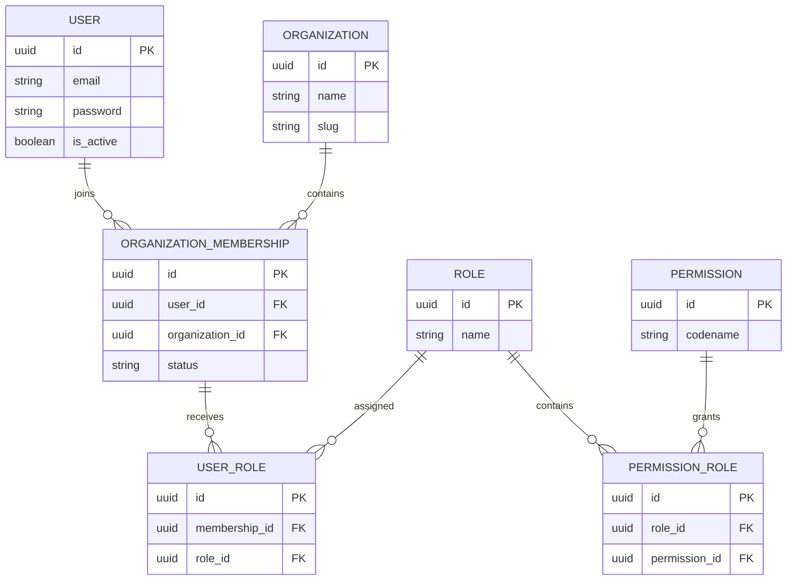

# SkyID — Centralized Identity & Access Management Platform

**SkyID** is a centralized Identity and Access Management (IAM) platform designed to provide secure authentication, authorization, user management, and organizational access control through a unified identity infrastructure.

Inspired by enterprise identity providers such as Okta and Keycloak, SkyID aims to simplify how applications manage identities, authenticate users, and enforce access permissions across multiple organizations and services.

The platform follows a modular architecture, separating identity management, authentication, authorization, and API services to support scalability, maintainability, and future integrations.

---

## Project Vision

To build a centralized identity infrastructure that enables organizations to securely manage users, control access to resources, and integrate authentication services across multiple applications.

## Core Features

### 1. Identity Management
- Centralized user registration and management.
- Custom user model.
- User profile management.
- Account activation and suspension.
- Secure password management.
- User identity lifecycle management.

### 2. Authentication
- Secure user authentication.
- Token-based authentication using JWT.
- Access and refresh token management.
- Password hashing and verification.
- Authentication endpoints for external applications.

### 3. Multi-Tenant Organization Management
- Create and manage organizations.
- Associate users with multiple organizations.
- Organization membership management.
- Organization-specific roles and permissions.
- Membership lifecycle management.

### 4. Role-Based Access Control (RBAC)

SkyID implements a Role-Based Access Control architecture to manage permissions across organizations.

The authorization model includes:

- **Roles:** Define what users are allowed to do.
- **Permissions:** Represent specific actions within the system.
- **User Roles:** Assign roles to users.
- **Role Permissions:** Associate permissions with roles.
- **Organization Memberships:** Define a user's relationship with an organization.

### 5. API Infrastructure
- RESTful API architecture.
- Modular service organization.
- Authentication and authorization middleware.
- API health monitoring.
- Structured error handling.
- API documentation.

---

## Technology Stack

| Component | Technology |
|---|---|
| Primary Backend | Django |
| API Framework | Django REST Framework |
| Secondary API Layer | FastAPI |
| Database | PostgreSQL |
| ORM | Django ORM / SQLAlchemy |
| Authentication | JWT |
| Password Security | Argon2 / Django Password Hashers |
| API Documentation | OpenAPI / Swagger |
| Containerization | Docker |
| Version Control | Git & GitHub |

---

## System Architecture

SkyID follows a modular backend architecture in which different services have clearly defined responsibilities.

```text
                 CLIENT APPLICATIONS
                         |
                         v
                  API ENTRY POINT
                         |
              +----------+----------+
              |                     |
              v                     v
        DJANGO BACKEND         FASTAPI SERVICES
              |                     |
       +------+------+       +------+------+
       |             |       |             |
       v             v       v             v
   Identity       Organization  Authentication  Authorization
   Management     Management    Services         Services
       |             |       |             |
       +-------------+-------+-------------+
                         |
                         v
                    PostgreSQL
```

**Architectural responsibilities:**

- **Django:** Core application, identity management, organization management, administration, and primary business logic.
- **Django REST Framework:** REST API endpoints and application integration.
- **FastAPI:** Dedicated service layer for independently exposed authentication and authorization functionality.
- **PostgreSQL:** Central relational database.
- **SQLAlchemy:** Database interaction within the FastAPI service layer.

*Note: The architecture is a development target and may evolve as the project progresses.*

---

## Database Design

The initial database design focuses on identity management, multi-tenancy, and authorization.

### Core Entities

| Entity | Responsibility |
|---|---|
| User | Stores user identity and account information |
| Organization | Represents an organization or tenant |
| OrganizationMembership | Connects users to organizations |
| Role | Defines organizational roles |
| Permission | Defines individual access permissions |
| UserRole | Assigns roles to users |
| PermissionRole | Maps permissions to roles |

### Entity Relationships



### Membership Lifecycle

Organization memberships support the following states:

- `INVITED` — User has been invited but has not yet joined.
- `ACTIVE` — User has access to the organization.
- `SUSPENDED` — User's organizational access has been temporarily disabled.

---

## Project Structure

The intended backend structure follows a modular organization:

```text
SkyID/
│
├── Backend/
│   ├── django_app/
│   │   ├── config/
│   │   ├── users/
│   │   ├── organizations/
│   │   ├── roles/
│   │   ├── permissions/
│   │   ├── authentication/
│   │   ├── manage.py
│   │   └── pyproject.toml
│   │
│   └── fastapi_service/
│       ├── app/
│       │   ├── api/
│       │   ├── core/
│       │   ├── models/
│       │   ├── schemas/
│       │   ├── services/
│       │   └── main.py
│       └── pyproject.toml
│
├── docs/
│   ├── architecture/
│   ├── database/
│   └── api/
│
├── infrastructure/
│   └── docker/
│
├── .gitignore
└── README.md
```

*The directory structure represents the planned organization and can be adjusted to match the actual repository.*

---

## Getting Started

### Prerequisites

Ensure the following tools are installed:

- Python 3.12+
- PostgreSQL
- Git
- Docker (optional)
- uv (Python package manager)

### 1. Clone the Repository

```bash
git clone https://github.com/YOUR_USERNAME/SkyID.git

cd SkyID
```

### 2. Navigate to the Backend

```bash
cd Backend/django_app
```

### 3. Create a Virtual Environment

```bash
uv sync
```

### 4. Configure Environment Variables

Create a `.env` file in the Django application directory.

```env
DEBUG=True
SECRET_KEY=your-secret-key

DB_NAME=skyid_db
DB_USER=cybercord
DB_PASSWORD=your-database-password
DB_HOST=localhost
DB_PORT=5432
```

Never commit production secrets or database credentials to GitHub.

### 5. Apply Database Migrations

```bash
uv run python manage.py makemigrations

uv run python manage.py migrate
```

### 6. Create an Administrator

```bash
uv run python manage.py createsuperuser
```

### 7. Start the Development Server

```bash
uv run python manage.py runserver
```

The development server will be available at:

```text
http://127.0.0.1:8000/
```

---

## API Endpoints

The following endpoints represent the planned API structure.

| Method | Endpoint | Description |
|---|---|---|
| GET | `/api/health/` | API health check |
| POST | `/api/auth/register/` | Register a user |
| POST | `/api/auth/login/` | Authenticate a user |
| POST | `/api/auth/refresh/` | Refresh access token |
| GET | `/api/users/me/` | Retrieve authenticated user |
| GET | `/api/organizations/` | List organizations |
| POST | `/api/organizations/` | Create an organization |
| GET | `/api/roles/` | Retrieve available roles |
| GET | `/api/permissions/` | Retrieve permissions |

These endpoints are part of the proposed API design; availability depends on implementation progress.

---

## Security Considerations

Security is a fundamental requirement of SkyID.

The development roadmap includes:

- Secure password hashing.
- JWT signature verification.
- Access token expiration and refresh rotation.
- Role-based authorization.
- Organization-level access isolation.
- Input validation and sanitization.
- Protection against common web vulnerabilities.
- Secure environment variable management.
- Authentication rate limiting.
- Audit logging for sensitive operations.

---

## Development Roadmap

| Phase | Deliverable | Status |
|---|---|---|
| Phase 1 | Project architecture and requirements | In Progress |
| Phase 2 | Database design and custom User model | Planned |
| Phase 3 | Authentication and JWT implementation | Planned |
| Phase 4 | Organization and membership management | Planned |
| Phase 5 | RBAC implementation | Planned |
| Phase 6 | FastAPI service integration | Planned |
| Phase 7 | Automated testing and security hardening | Planned |
| Phase 8 | Containerization and deployment | Planned |

---

## Engineering Principles

SkyID is being developed with the following principles:

- **Security First:** Protect identities and organizational resources.
- **Modularity:** Keep system components independent and maintainable.
- **Scalability:** Design for increasing users, organizations, and applications.
- **Separation of Concerns:** Keep authentication, authorization, and identity management logically separated.
- **API First:** Provide consistent interfaces for application integration.
- **Maintainability:** Follow clean code practices and established software engineering standards.

---

## Future Enhancements

Potential future capabilities include:

- Single Sign-On (SSO).
- OAuth 2.0 and OpenID Connect (OIDC).
- Multi-Factor Authentication (MFA).
- Social authentication.
- API key management.
- Service-to-service authentication.
- Enterprise audit trails.
- Session management.
- External identity provider integration.
- Administrative dashboard.

---

## Contributing

Contributions, suggestions, and discussions are welcome.

1. Fork the repository.
2. Create a feature branch.
3. Implement your changes.
4. Add relevant tests.
5. Submit a pull request.

Follow the project's coding standards and ensure tests pass before submitting changes.

---

## License

This project is currently under development. Licensing information will be added when the project license is finalized.

---

**SkyID — One Identity. Multiple Applications. Centralized Access.**

*Building secure identity infrastructure for modern applications.*
